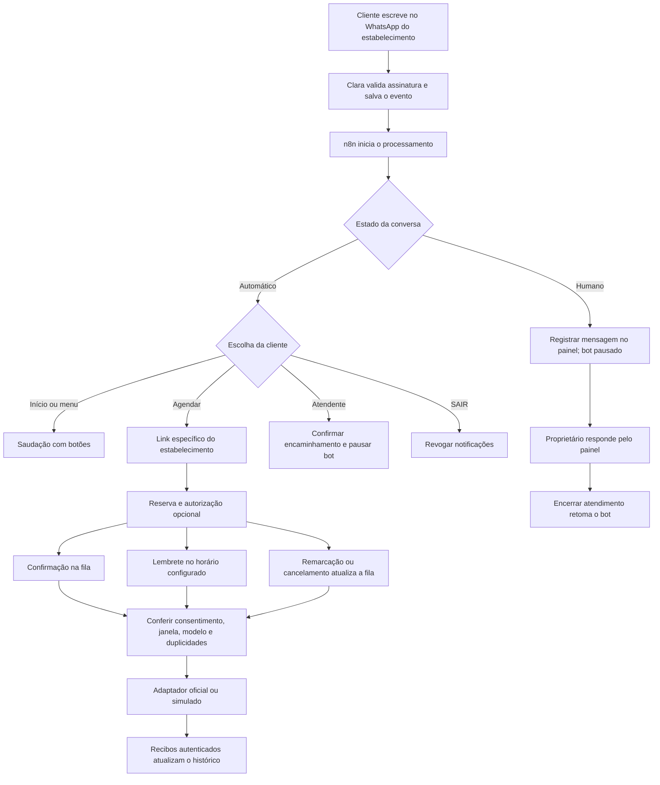

# Clara — atendimento completo

> **STANDBY desde 14/10/2026.** O serviço está escondido dos usuários. Sem `VITE_WHATSAPP_ENABLED=true` no build, o menu/página "Conversas WhatsApp" e a autorização na reserva não existem no pacote, e a reserva pública continua usando `book_appointment_team`. O simulador local (`npm run whatsapp:sim` + `npm run dev:whatsapp`) liga o serviço só no modo de desenvolvimento. Para reativar: aplicar `whatsapp.sql` e `whatsapp_operations.sql` na ordem documentada, publicar as funções `booking` e `whatsapp` e, por último, gerar o frontend com `VITE_WHATSAPP_ENABLED=true`.

Estado em 13/10/2026: código, banco local, painel e workflows montados. O fluxo local está ativo; o oficial está importado e **inativo**, aguardando configuração/homologação na Meta. Nenhum envio real, cadastro Meta, migração remota ou deploy foi executado. O bloqueio 130497 continua fora do escopo. Este documento substitui, nos pontos alterados, o estado da primeira entrega em `WHATSAPP-N8N.md`.

## Fluxo da cliente

O menu oficial usa botões `Agendar` e `Falar com atendente`; os textos `1`, `2`, `agendar`, `atendente` e `menu` também funcionam. A confirmação de encaminhamento humano é enviada uma única vez por transição; depois, respostas automáticas e notificações aguardam o encerramento. A saudação não se repete a cada mensagem. O sistema mantém as regras de reservas, recursos, profissionais, fuso, consentimento, prazo dos lembretes e estados de envio da implementação anterior.

## O que está instalado no n8n

| Workflow | ID | Estado nesta instalação |
| --- | --- | --- |
| Clara — Atendimento completo [LOCAL] | `ClaraFullLocal01` | Publicado/ativo, apenas servidor simulado |
| Clara — Atendimento completo [OFICIAL] | `ClaraFullLive01` | Importado, inativo, URL do Supabase atual preparada; função/credencial aguardando publicação/configuração |
| Clara — Fila de confirmações e lembretes [SIMULAÇÃO] | `ClaraWaQueueSim01` | Preservado e despublicado; substituído pelo completo |
| Clara — Cliente inicia conversa [SIMULAÇÃO] | `ClaraWaInboxSim01` | Preservado, manual |
| Fluxo inicial informado pelo usuário | `fWw0sNDvnpUn1Vr1` | Preservado, sem alterações nesta entrega |

Cada workflow completo possui:

1. **Iniciar operação**: acionamento manual de manutenção.
2. **Verificação a cada minuto**: recuperação periódica e vencimento de notificações.
3. **Acordar com novo evento**: webhook autenticado, sem dados da cliente; reduz a espera quando chega uma mensagem.
4. **Receber e encaminhar atendimentos**: consome a entrada persistente na Clara, interpreta escolhas, pausa humana e recibos.
5. **Enviar respostas e notificações devidas**: processa a fila usando as regras da Clara e a credencial daquele estabelecimento.
6. **Verificar pendências e falhas**: consulta contadores operacionais, sem conteúdo/telefones.
7. **Precisa de atenção?**: decide se há falhas, resultados incertos ou eventos de entrada atrasados.
8. **Registrar incidente sem dados pessoais**: abre/atualiza um incidente persistente, evitando criar um incidente repetido a cada ciclo.
9. **Ciclo concluído**: encerra a execução.

Há também uma nota explicando a arquitetura no próprio canvas. As regras de conversa ficam no banco/servidor da Clara para que o botão manual, o webhook e o relógio não possam tomar decisões contraditórias. O n8n orquestra etapas reais; não faz consultas diretas às tabelas nem recebe credenciais dos estabelecimentos.

Importação: `integrations/n8n/clara-atendimento.local.json` e `clara-atendimento.oficial.json`. Ambos são exportados inativos. `npm run whatsapp:workflows` gera todos os arquivos; `scripts/configure-n8n-operations.ps1` importa os dois novos na instalação Docker local sem reimportar os antigos. O local reaproveita a credencial Header Auth já cadastrada.

## Conexão por estabelecimento

O painel **Conversas WhatsApp → WhatsApp do estabelecimento** inclui preparar a conexão, continuar na Meta, reconectar, conferir modelos aprovados e desconectar. O botão fica desabilitado quando a plataforma ainda não configurou os requisitos, em vez de simular uma conexão bem-sucedida.

O cadastro usa o SDK oficial/Embedded Signup; o servidor autentica o JWT Supabase, confere o proprietário, cria uma sessão de dez minutos com uso único e limita tentativas. A conclusão troca o código no servidor, verifica aplicativo e permissões do token, confere que o número pertence à WABA autorizada, assina seus eventos e salva a conexão. O cliente nunca fornece um token permanente ao frontend/n8n.

Cada token é cifrado com **AES-256-GCM**, nonce aleatório e vínculo criptográfico ao `studio_id`. Os registros ficam no schema privado sem acesso de `anon`/`authenticated`; a chave mestra fica nos segredos da Edge Function. O envio consulta a credencial por estabelecimento **e número**, sem recorrer a uma credencial global. Repetir/cancelar/substituir o cadastro não permite concluir uma sessão antiga. Um número não pode ser vinculado a dois estabelecimentos.

Conectar não ativa automaticamente mensagens: o estabelecimento fica pausado até revisar registro/modelos/configuração. Trocar/reconectar o canal cancela mensagens ainda pendentes e limpa a configuração de modelos para nova conferência. Desconectar desativa a fila e apaga o token cifrado da conexão, mantendo histórico; também invalida cadastros em andamento. O vínculo do aplicativo na Meta pode ser revogado pelo proprietário nas configurações de sua empresa. A Clara não desregistra o número nem remove uma assinatura de WABA compartilhada por outros números.

Para número novo no fluxo padrão Cloud API, há uma ação separada de registro, com PIN de seis dígitos informado pelo proprietário e não armazenado. Não executamos essa ação. O caminho de coexistência com o aplicativo WhatsApp Business é opcional e permanece desligado; sua disponibilidade depende da conta/permissões da Meta e precisa de homologação específica. A implementação exige retorno de WABA e número; não presume qual número escolher se a Meta retornar apenas a conta.

**Conferir modelos aprovados** consulta a Meta e aceita os nomes `clara_confirmation_v1`, `clara_reminder_v1`, `clara_reschedule_v1`, `clara_cancellation_v1` e `clara_human_followup_v1`, em `pt_BR`, aprovados como utilidade. Os quatro primeiros exigem exatamente seis parâmetros de corpo; a retomada é estática. Componentes extras/incompatíveis são rejeitados. A Meta determina a aprovação/categoria; modelos não encontrados continuam bloqueados. Rascunhos: `integrations/whatsapp/templates.json`.

## Entrada persistente e endpoints

O webhook oficial confirma o recebimento **depois** de salvar o evento assinado na inbox do banco. Falha de banco devolve erro para a Meta repetir. A repetição do mesmo corpo é deduplicada por SHA-256, e os IDs de mensagem/recibo também são deduplicados ao processar envelopes diferentes. Cada evento é transacional; um evento inválido não reverte outro. Há até cinco tentativas de entrada, com recuo, antes de registrar falha para investigação. Esse limite é separado das quatro tentativas controladas da fila de saída.

Novas rotas sob `/functions/v1/whatsapp`:

| Rota | Autenticação / finalidade |
| --- | --- |
| `POST /connection` | JWT Supabase do proprietário + `studio_id`; ações `status`, `begin`, `complete`, `register`, `templates`, `disconnect`. CORS restrito a `APP_ORIGIN`. Nunca retorna token. |
| `POST /inbox` | Bearer da ponte n8n; processa até 30 envelopes pendentes do modo atual. |
| `POST /health` | Mesmo Bearer; retorna contadores de fila, falhas, entradas atrasadas e solicitações humanas. |
| `POST /incident` | Mesmo Bearer; registra/atualiza incidente operacional sem PII. |
| `POST /process` | Mesmo Bearer; processa entradas antes das saídas. Se modo live estiver sem liberação de envio, bloqueia antes de reivindicar saídas. |
| `GET/POST /webhook` | Verificação de desafio e assinatura Meta; entrada live pode funcionar com envio ainda desabilitado. |

`N8N_WAKE_URL` é opcional: após persistir o evento, a Edge Function tenta acordar o n8n em segundo plano, com Bearer e corpo vazio. Se o n8n estiver fora do ar, a inbox permanece; o relógio recupera o trabalho. Não há garantia de processamento instantâneo durante indisponibilidade. Confirmar assinatura/recibo continua sendo responsabilidade da Clara.

Falhas/incertezas de saída continuam visíveis no histórico. O `/health` considera somente falhas definitivas da última hora (mensagens e eventos de entrada); sem novas falhas, o incidente é encerrado e o registro histórico permanece. Números brasileiros recebidos da Meta sem o nono dígito (55+DDD+8 dígitos iniciados por 6–9) são tratados como o mesmo celular com o 9, inclusive para SAIR. Unificar cadastros mantém confirmação/lembrete somente quando o cadastro principal tem o mesmo número autorizado; número diferente ou ausente invalida a autorização. Incidentes globais são registros operacionais privados, consumidos pelo fluxo/operador; não disparam e-mail/WhatsApp externo. Não há reenvio automático de resultado incerto. Para investigar uma falha de entrada, localizar o evento privado, corrigir a causa e só então planejar uma repetição controlada; não apagar provas de consentimento nem reabrir toda a fila.

## Configuração para produção

1. Homologar/publicar as dependências existentes de agenda, `whatsapp.sql` e depois **`whatsapp_operations.sql`**. A segunda migração adiciona tabelas/funções e amplia uma constraint para a confirmação de encaminhamento; não remove dados. Publicar funções `booking`/`whatsapp` antes do frontend. Nenhuma migração remota foi executada aqui.
2. Concluir a configuração/verificações da Clara como Tech Provider, aplicativo/permissões e configuração de Embedded Signup na Meta. Conferir domínios HTTPS permitidos e a configuração efetivamente liberada para o aplicativo. O cliente autoriza sua conta no fluxo oficial; a Clara não pede senha do Facebook.
3. Configurar os segredos abaixo e webhook HTTPS público da Clara na Meta. Habilitar o onboarding somente após a configuração e revisão. Conectar o estabelecimento, concluir registro se necessário e sincronizar modelos aprovados.
4. O workflow **OFICIAL** já aponta os quatro nós HTTP para `https://gtqcehwvddvqllicnreu.supabase.co/functions/v1/whatsapp`, projeto atual da Clara; a função nova ainda não foi publicada. Para homologação em outro projeto, trocar a origem nesses quatro nós (ou gerar com `CLARA_WHATSAPP_BASE_URL`). Criar credencial Header Auth `Clara — ponte oficial` com `Authorization: Bearer <segredo da ponte>` e vinculá-la aos quatro nós HTTP e ao webhook de despertar.
5. Se usar despertar imediato, disponibilizar o webhook **n8n de produção** por HTTPS e configurar `N8N_WAKE_URL` com sua URL `/webhook/clara-operations`. Não usar `/webhook-test/`. A Meta sempre chama o webhook da Clara. Se o n8n continuar só no computador, pode operar pelo relógio consultando a função pública, sem expor o n8n.
6. Resolver o erro 130497 fora desta implementação. Validar em homologação login, retorno de WABA/número, token, registro, modelos, assinaturas e recibos reais. O SDK/Graph precisam ser homologados com a configuração da conta, pois não havia credenciais Meta utilizáveis nesta entrega.
7. Só na liberação autorizada, usar `WHATSAPP_MODE=live`, `WHATSAPP_LIVE_ENABLED=true`, habilitar o estabelecimento e publicar o workflow oficial. Há travas independentes; nenhuma delas foi ativada nesta entrega.

O servidor não usa mais `META_ACCESS_TOKEN` compartilhado. A chave de criptografia deve ter backup seguro: trocar seu valor sem recifrar os tokens exige reconectar estabelecimentos. Nunca coloque segredos em `VITE_*` ou nos JSONs dos workflows.

| Variável | Uso |
| --- | --- |
| `SUPABASE_URL`, `SUPABASE_SERVICE_ROLE_KEY` | Servidor Supabase, como antes. |
| `APP_PUBLISHABLE_KEY` | Gateway `booking`, já existente. |
| `APP_ORIGIN` | Origem HTTPS pública da Clara, sem caminho, também usada em CORS. |
| `CLARA_N8N_SECRET` | Segredo da ponte, mínimo 32 caracteres aleatórios; servidor e credencial n8n. |
| `WHATSAPP_MODE` | `simulation` ou `live`. |
| `WHATSAPP_LIVE_ENABLED` | Liberação explícita do envio; começa `false`. |
| `META_APP_ID`, `META_SIGNUP_CONFIG_ID` | IDs públicos de configuração, fornecidos pelo servidor ao SDK quando habilitado. |
| `META_APP_SECRET`, `META_VERIFY_TOKEN` | Segredos da aplicação/webhook. |
| `META_GRAPH_VERSION` | Versão suportada, a conferir na homologação. |
| `META_ONBOARDING_ENABLED` | Libera o cadastro de números; começa `false`. |
| `META_SIGNUP_COEXISTENCE` | Opção de coexistência, começa `false`; validar elegibilidade antes de usar. |
| `WHATSAPP_TOKEN_ENCRYPTION_KEY` | 32 bytes aleatórios em 64 caracteres hexadecimais; exclusivamente servidor. |
| `N8N_WAKE_URL` | Opcional; URL HTTPS do webhook autenticado do workflow completo. |

Exemplo sem segredos: `integrations/whatsapp/server.env.example`. As variáveis públicas `VITE_SUPABASE_URL`/`VITE_SUPABASE_PUBLISHABLE_KEY` e o modo local continuam como documentados na primeira entrega.

## Endereços locais e verificação

Iniciar com `npm run whatsapp:sim` e `npm run dev:whatsapp`. Painel: `http://127.0.0.1:3000/#/demo/conversas`. n8n: `http://localhost:5678/workflow/ClaraFullLocal01`. Os nós no container acessam `http://host.docker.internal:8787`; o servidor no Windows acorda o n8n em `http://127.0.0.1:5678/webhook/clara-operations-local`. São endereços diferentes porque `localhost` dentro do container é o próprio container.

O botão de entrada local também grava na inbox persistente e acorda o fluxo completo. Para desligar o servidor local, despublique o workflow LOCAL para evitar erros de conexão. O OFICIAL permanece inativo.

Verificações: **468 testes** da aplicação aprovados, **5 testes de concorrência** em PostgreSQL nativo aprovados, build aprovado (avisos antigos Lucide). Cobertura inclui token cifrado/vínculo ao estabelecimento, adulteração, autorização, sessão única/expirada, desconexão durante cadastro, replay de webhook, falha isolada com tentativas limitadas, incidente único, credencial por número, botões, pausa humana e filas concorrentes. Workflow completo executado com sucesso no n8n; entrada → encaminhamento humano → confirmação simulada → pausa conferidos no painel. Cadastro Meta/envio/entrega real ainda não foram homologados.

## Fontes consultadas

As regras de janela de atendimento, modelos e cobrança permanecem as da [política oficial](https://business.whatsapp.com/policy) e da [página de preços](https://business.whatsapp.com/products/platform-pricing). Não há franquia presumida de mil mensagens, nem HTTP aceito apresentado como entregue.

Contratos consultados na coleção oficial da Meta: [números de uma WABA](https://www.postman.com/meta/whatsapp-business-platform/request/86mq7mn/get-phone-numbers), [registro do número](https://www.postman.com/meta/whatsapp-business-platform/request/zb2u18b/register-phone) e [assinatura de eventos da WABA](https://www.postman.com/meta/whatsapp-business-platform/documentation/wlk6lh4/whatsapp-cloud-api?entity=request-13382743-eb9a6721-1056-4db2-b00a-2290e04b5b5d). O [guia oficial da Twilio](https://www.twilio.com/docs/whatsapp/isv/tech-provider-program/integration-guide) foi usado para conferir o contrato do SDK/retorno do Embedded Signup; nenhuma dependência ou conta Twilio foi adicionada. As páginas técnicas diretas da Meta responderam 429; a configuração final deve ser conferida no App Dashboard durante a homologação. Não se pressupõe que uma conexão simulada substitua a aprovação da Meta.
